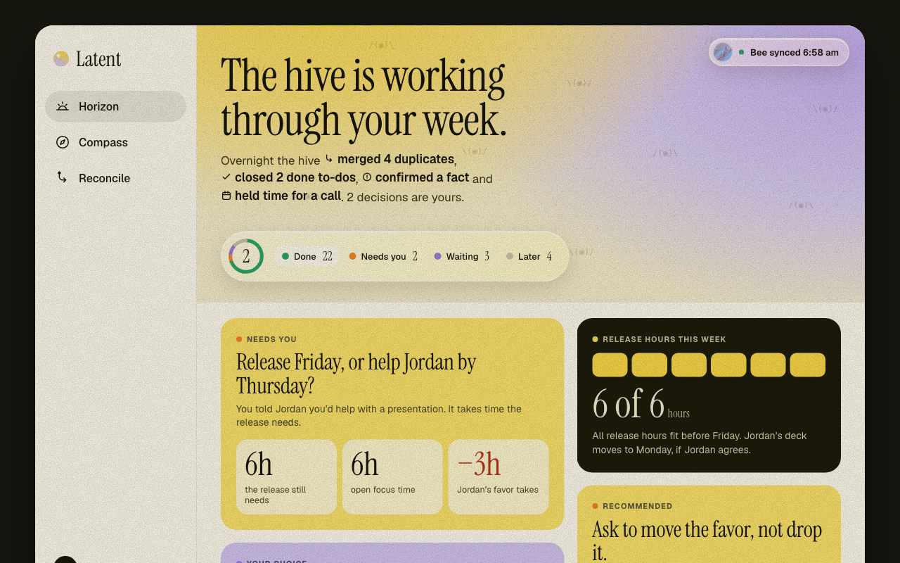
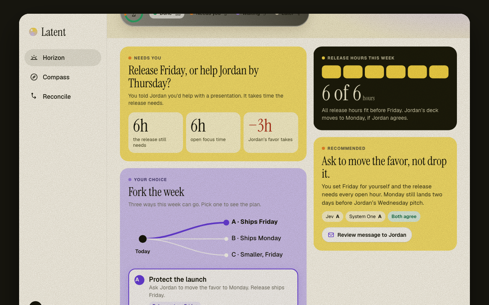

# am·bee·nt

**Ambeent. Room for what matters.**

Bee remembers everything you say. Ambeent decides what's worth your attention.

Ambeent (pronounced *ambient*) is an ambient agent that sits on top of your [Bee](https://bee.computer) record. It reads what you promised, checks it against your calendar and the rest of your record, quietly handles the small stuff, and brings you only the decisions that are actually yours. It does not add another list to look at. It takes things off the one you already have.



## Why

Bee captures a year of conversations and turns them into to-dos and facts. The result is a pile: duplicates, things already done, promises other people made, old intentions nobody dropped. The pile grows faster than anyone can read it, and more data does not mean more clarity.

Ambeent's answer is to do three things well:

1. **Handle what's low effort.** Merge duplicates, close what's demonstrably done, hold time for what you already decided. Every action has a receipt, an owner, and an undo.
2. **Show the choice, not the data.** When two things you said collide, Ambeent shows the real tradeoff in hours and lets you fork the week, so you can see each path before you take one.
3. **Check Bee's record against the world.** Old to-dos and unconfirmed facts get compared with your calendar and later conversations. Resolved work is cleared. Whatever is left is what actually needs you.

Rest, deferral and dropping work count as good outcomes. Ambeent never scores you, and it never tells you what you "really" want. Its readings are suggestions you can correct.

## Three screens

| | |
|---|---|
| **Horizon** | Your week as a decision. The hive's overnight work, what needs you, and **Fork the week**: three paths with their consequences on a real timeline. Approve one and the hive acts, then shows a receipt. |
| **Compass** | Where your time is heading. Editable goals, a one-tap daily check-in, week/month/year capacity, and a hive that grows with every conversation. Ambeent can also notice goals you act on but never wrote down. |
| **Reconcile** | Bee's old to-dos and unconfirmed facts, checked against evidence. Duplicates merge, resolved items close, and the models' disagreements come to you. |



## The Friday story

An independent builder wants a first release out Friday. It needs six focused hours. Yesterday they told Jordan, "Sure, I'll help with the deck by Thursday." That favor takes three of those hours.

Ambeent shows the conflict in numbers, then three paths:

- **A. Protect the launch.** Ask Jordan to move the favor to Monday. The release ships Friday.
- **B. Keep the favor.** Help Jordan Tuesday. The release moves to Monday.
- **C. Ship smaller.** Keep both promises with a smaller first release.

Jev and System One (the decision models) each pick a path. If they agree, Ambeent recommends it. If they split, it asks. Approve A and the hive writes the message from your demo account, holds Tuesday and Thursday, and reports back. The result card says what it can honestly say: **a request is not a yes.** Jordan still has to agree.

## Who said it matters

Ambeent treats a promise differently depending on who made it.

- **You said it.** The hive can draft, hold time and follow through for you.
- **Someone told you.** The hive remembers it and waits. It never acts on someone else's promise.
- **Not sure who said it.** Ambeent asks. It does not guess.

## What's real and what's simulated

This is a hackathon build. The line between the two is deliberate and stated here.

| | Status |
|---|---|
| Bee ingest into a local SQLite ledger, with bystander speech dropped before storage | **Working.** Tested against one real account (169 conversations, 421 facts, 162 to-dos). A live sync pulls new conversations in. |
| Reconcile: exact-duplicate detection, reversible merge, evidence-or-hold for facts | **Working.** Semantic duplicates are not built yet. |
| Capacity engine: free time from `.ics` calendars, effort vs. deadline, A/B/C comparison API | **Working** on a coherent synthetic launch scenario. |
| Actions: hash-bound approval, idempotent execution, durable receipts, partial-failure handling | **Working** in a sandbox. Real Gmail and Calendar sends are off until a demo account is connected. |
| MCP server and agent skill: ten tools any agent can call, including `latent_fork_week`, plus a skill that teaches the workflows and rules | **Working.** See [docs/mcp.md](docs/mcp.md) and [skills/ambeent](skills/ambeent/SKILL.md). |
| Live Bee stream with reconnect and catch-up | **Working** from fixtures. A captured event is replayed in the demo and labeled as a replay. |
| The app (Horizon, Compass, Reconcile) | **Working.** One interface, two modes. **Demo** plays the scripted Friday story on synthetic data. **Your Bee** reads your local ledger and calendar: real to-dos, duplicates, facts, conversation history, a fork computed on your calendar, and sandbox or Google actions with receipts. |
| Jev and System One | **Wired.** Add an OpenAI-compatible base URL, model and key for each in Settings (stored in the git-ignored `.env`), test the connection, score rows, or ask both about a promise. Verdicts in Demo mode are illustrative; no evaluation results are claimed. |
| Speaker attribution | **Known gap.** Bee reports `Unknown` on this account, so Ambeent never claims to know your voice. |
| Outcome prediction and forecasts | **Not built.** No independent labels exist, so Ambeent shows hours and arithmetic, not probabilities. |

Open items before submission are tracked in [docs/OPEN-ITEMS.md](docs/OPEN-ITEMS.md).

## Try it

Requires Node 22.13 or newer.

```bash
cd app
npm ci
npm run demo        # synthetic data, no Bee needed: http://127.0.0.1:4317
npm test            # offline suite
```

**With your own Bee:** `npm run ingest` reads your account into `app/data/` (git-ignored), then `npm start`. Switch the top-right toggle from **Demo** to **Your Bee**. Put `.ics` exports in `app/data/calendars/` for the capacity engine. Keep `npm run stream` running in another terminal and new conversations appear in Horizon as Bee records them.

**Decision models:** open Settings (the gear) and add Jev and System One. Any OpenAI-compatible endpoint works. Keys are written to the root `.env`, never sent back to the browser.

**Real actions:** by default actions run in a sandbox and nothing leaves your machine. To send from a dedicated demo account, see [app/README.md](app/README.md#dedicated-google-demo-account).

**On your phone:** `LATENT_BIND=0.0.0.0 LATENT_HOSTS=<your-tailscale-ip> npm start`, then open `http://<your-tailscale-ip>:4317`. Only do this on a private network.

**From an agent (MCP):**

```bash
claude mcp add latent -- node /absolute/path/to/app/mcp-server.mjs
```

Then ask: *what should I act on?* or *can I help Jordan with the deck by Thursday?* The [agent skill](skills/ambeent/SKILL.md) teaches the workflows.

The static design reference lives in [`design/latent-v5.html`](design/latent-v5.html).

## How it fits together

```
 Bee (wearable, CLI, API)
        |  conversations, to-dos, facts
        v
 Local ledger (SQLite, bystanders dropped)
        |
        +--> Evidence engine ------ later conversations, calendar (.ics)
        |         "is this resolved? is this the same task?"
        |
        +--> Capacity engine ------ free hours vs. effort vs. deadlines
        |         "what does each path actually cost?"
        |
        +--> Decision models ------- Jev, System One
        |         "act, ask, remember, or ignore?"
        v
 Hive (approval, one executor per action, receipts, undo)
        |
        +--> Gmail / Calendar connectors (demo account)
        +--> Other agents through MCP
        +--> Bee's own agent
```

Ambeent owns the context, the tradeoff, the recommendation, the approval and the result record. Anything that can execute an approved action may do so, but one approved action never runs through two executors.

## Principles

- **A draft is not a send. A request is not an agreement. A hold is not attendance.** Each state is named exactly.
- **Unknown stays unknown.** Missing evidence, missing models and missing attribution are shown, not smoothed over.
- **Local first.** The ledger lives on your machine. Real data never goes in this repository.
- **Nothing happens without your approval,** and everything can be undone.

## Repository

| Path | What's there |
|---|---|
| [`app/`](app/) | The local service, SQLite ledger, evidence and capacity engines, MCP server, and the app (`public/v5.*`) |
| [`design/`](design/) | The static design reference and the material it was designed from |
| [`docs/`](docs/) | Scope, design direction, glossary, MCP guide, decision records, demo script, archived specs |
| [`skills/ambeent/`](skills/ambeent/) | The agent skill for the MCP tools |
| [`docs/adr/`](docs/adr/) | Why the product makes the claims it makes, and the ones it refuses to |

## License

[MIT](LICENSE). Third-party assets and fonts keep their own licenses; see [docs/OPEN-ITEMS.md](docs/OPEN-ITEMS.md) for what still needs to be cleared before this repository goes public.
