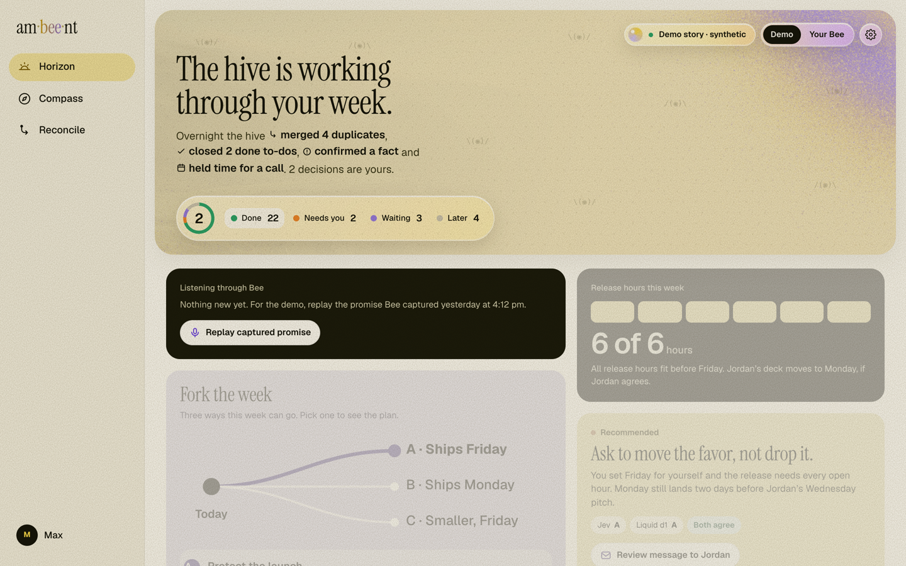
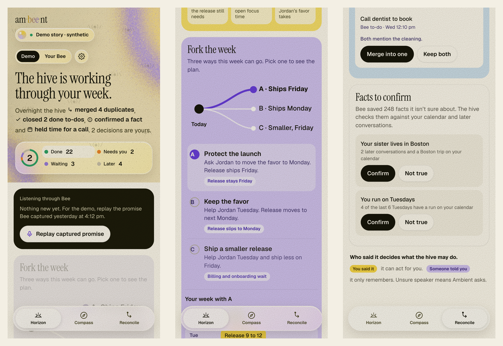
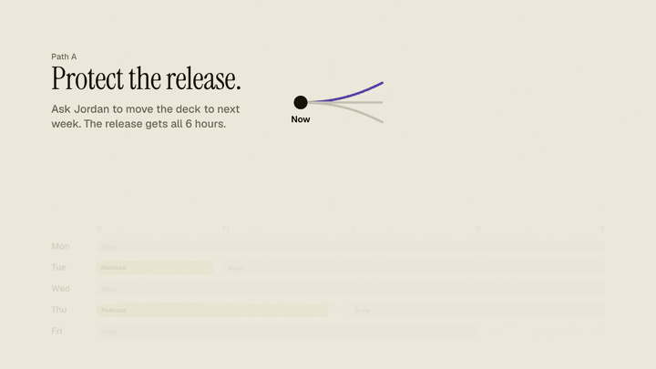
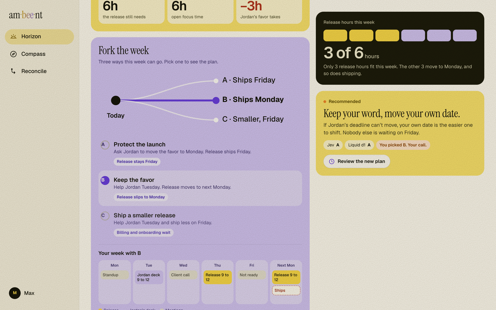

# ambient

**Room for what matters.**

[Try the interactive demo](https://maximilienmil.github.io/ambient/) (synthetic data, simulated actions). Run the local app below for real Bee and connector access.

Bee remembers everything you say. Ambient decides what's worth your attention.

> **Elevator pitch:** Ambient turns Bee conversations into action, checks promises against your calendar, explains when it acts or waits, keeps receipts, and coordinates with others' agents. No group chat needed.

Ambient sits on top of your [Bee](https://bee.computer) record. It reads what you promised, checks it against your calendar and the rest of the record, handles the small stuff so you don't have to look at it, and brings you only the decisions that are actually yours. It does not add another list to look at. It takes things off the one you already have.





## Why

A year of conversations becomes a pile. Bee turns what you said into to-dos and facts, and the pile is mostly duplicates, things already done, promises other people made, and old intentions nobody dropped. It grows faster than anyone can read it, and more data does not mean more clarity.

Ambient does three things.

1. **Handles what's low effort.** Merges duplicates, closes what's demonstrably done, holds time for what you already decided. Actions have an owner and a receipt. Local duplicate merges can be undone.
2. **Shows the choice, not the data.** When two things you said collide, Ambient shows the real tradeoff in hours and lets you fork the week. You see each path before you take one.
3. **Checks Bee's record against the world.** Old to-dos and unconfirmed facts get compared with your calendar and later conversations. Resolved work is cleared. What's left is what actually needs you.

Rest, deferral and dropping work count as good outcomes. Ambient never scores you and never tells you what you "really" want. Its readings are suggestions you can correct.

## Three screens

| | |
|---|---|
| **Horizon** | Your week as a decision. The hive's overnight work, what needs you, and **Fork the week**: three paths with their consequences on a real timeline. Approve one and the hive acts, then shows a receipt. |
| **Compass** | Where your time is heading. Editable goals, a one-tap daily check-in, week/month/year capacity, and a hive that grows with every conversation. Ambient can also notice goals you act on but never wrote down. |
| **Reconcile** | Bee's old to-dos and unconfirmed facts, checked against evidence. Duplicates merge, resolved items close, and the models' disagreements come to you. |





## Who said it matters

Ambient treats a promise differently depending on who made it.

- **You said it.** The hive can draft, hold time and follow through for you.
- **Someone told you.** The hive remembers it and waits. It never acts on someone else's promise.
- **Not sure who said it.** Ambient asks. It does not guess.

## What's real and what's simulated

This demo tells a story on synthetic data. The local app reads a real account.

| | Status |
|---|---|
| Bee ingest into a local SQLite ledger, with bystander speech dropped before storage | **Working.** Tested against one real account (169 conversations, 421 facts, 162 to-dos). A live sync pulls new conversations in. |
| Reconcile: exact-duplicate detection, reversible merge, evidence-or-hold for facts | **Working.** Semantic duplicates are not built yet. |
| Capacity engine: free time from `.ics` calendars, effort vs. deadline, A/B/C comparison API | **Working** on a coherent synthetic launch scenario. |
| Actions: hash-bound approval, idempotent execution, durable receipts, partial-failure handling | **Working.** By default actions run in a sandbox and nothing leaves your machine. Connect a dedicated demo Google account and the same actions send for real. |
| MCP server and agent skill: ten tools any agent can call over stdio or Streamable HTTP (MCP 2025-11-25), including `ambient_fork_week`, plus a skill that teaches the workflows and rules | **Working.** See [docs/mcp.md](docs/mcp.md) and [skills/ambient](skills/ambient/SKILL.md). |
| Live Bee stream with reconnect and catch-up | **Working.** Live events stream in as Bee records them. The demo replays a captured event so judges can see the whole flow in ninety seconds, and the replay is labeled as such. |
| The app (Horizon, Compass, Reconcile) | **Working.** One interface, two modes. **Demo** plays the scripted story on synthetic data. **Your Bee** reads your local ledger and calendar: real to-dos, duplicates, facts, conversation history, a fork computed on your calendar, and sandbox or Google actions with receipts. |
| Jev and Liquid d1 | **Wired.** Add an OpenAI-compatible base URL, model and key for each in Settings (stored in the git-ignored `.env`), test the connection, score rows, or ask both about a promise. Verdicts in Demo mode are illustrative; no evaluation results are claimed. |
| Outcome prediction and forecasts | **Best guess, not certainty.** Estimates are drawn from your own history, how often promises like yours get closed, and the hive sharpens them as it grows. No number here is a probability. |

## Try it

Requires Node 22.13 or newer.

```bash
cd app
npm ci
npm run demo        # synthetic data, no Bee needed: http://127.0.0.1:4317
npm test            # offline suite
```

**With your own Bee:** `npm run ingest` reads your account into `app/data/` (git-ignored), then `npm start`. Switch the top-right toggle from **Demo** to **Your Bee**. Put `.ics` exports in `app/data/calendars/` for the capacity engine. Keep `npm run stream` running in another terminal and new conversations appear in Horizon as Bee records them.

**Decision models:** Jev runs on **Amazon Bedrock** (see [docs/AWS.md](docs/AWS.md)): Settings → Jev → Use Amazon Bedrock. Open Settings (the gear) and add Jev and Liquid d1. Any OpenAI-compatible endpoint works. Keys are written to the root `.env`, never sent back to the browser.

**Real actions:** by default actions run in a sandbox and nothing leaves your machine. To send from a dedicated demo account, see [app/README.md](app/README.md#dedicated-google-demo-account).

**On your phone:** `AMBIENT_BIND=0.0.0.0 AMBIENT_HOSTS=<your-tailscale-ip> npm start`, then open `http://<your-tailscale-ip>:4317`. Only do this on a private network.

**From an agent (MCP).** Over stdio for Claude Code and other local agents, or over Streamable HTTP (spec 2025-11-25) at `http://127.0.0.1:4317/mcp` while the app runs. Remote callers need `AMBIENT_MCP_TOKEN` set and an `Authorization: Bearer` header.

```bash
claude mcp add ambient -- node /absolute/path/to/app/mcp-server.mjs
```

Then ask: *what should I act on?* or *can I help Jordan with the deck by Thursday?* The [agent skill](skills/ambient/SKILL.md) teaches the workflows.

Launch films are generated from code in [`launch/`](launch/): real app screenshots composed in HTML and rendered frame by frame. See [launch/README.md](launch/README.md).

The static design reference lives in [`design/ambient-v5.html`](design/ambient-v5.html).

## How it fits together

```
 Bee (wearable, CLI, API)
        |  conversations, to-dos, facts
        v
 Local ledger (SQLite, bystanders dropped)
        |
        +--> Evidence engine ------ later conversations, calendar (.ics)
        |         "is this resolved? is this the same task?"
        |
        +--> Capacity engine ------ free hours vs. effort vs. deadlines
        |         "what does each path actually cost?"
        |
        +--> Decision models ------- Jev, Liquid d1
        |         "act, ask, remember, or ignore?"
        |
        v
 Hive (approval, one executor per action, receipts, undo)
        |
        +--> Gmail / Calendar connectors (demo account)
        +--> Other agents through MCP
        +--> Bee's own agent
```

Ambient owns the context, the tradeoff, the recommendation, the approval and the result record. Anything that can execute an approved action may do so, but one approved action never runs through two executors.

## Principles

- **A draft is not a send. A request is not an agreement. A hold is not attendance.** Each state is named exactly.
- **Unknown stays unknown.** Missing evidence, missing models and missing attribution are shown, not smoothed over.
- **Local first.** The ledger lives on your machine. Real data never goes in this repository.
- **External actions require your approval.** Local duplicate merges can be undone; sent messages cannot be recalled.

## Repository

| Path | What's there |
|---|---|
| [`app/`](app/) | The local service, SQLite ledger, evidence and capacity engines, MCP server, and the app (`public/v5.*`) |
| [`design/`](design/) | The static design reference and the material it was designed from |
| [`docs/`](docs/) | Scope, design direction, glossary, MCP guide, decision records, demo script, archived specs |
| [`launch/`](launch/) | Screenshot capture and the five programmatic launch films |
| [`skills/ambient/`](skills/ambient/) | The agent skill for the MCP tools |
| [`docs/adr/`](docs/adr/) | Why the product makes the claims it makes, and the ones it refuses to |

## License

[MIT](LICENSE). Third-party assets and fonts retain their own licenses.